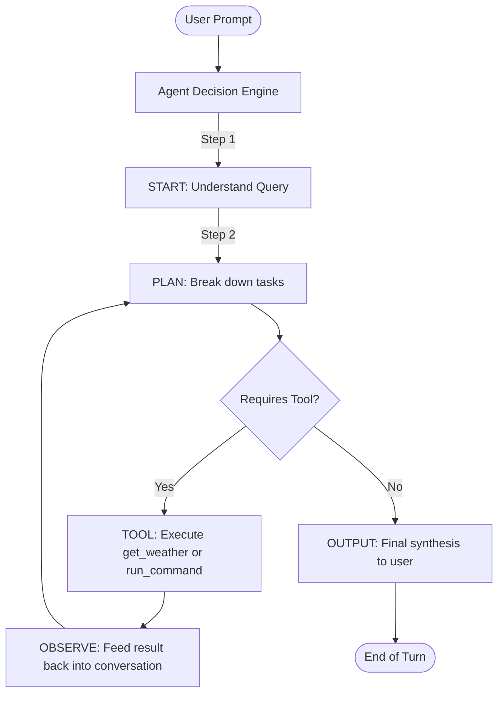

# 🌦️ ReAct Weather & Automation AI Agent

[](https://www.python.org/downloads/)
[](https://groq.com/)
[](https://docs.pydantic.dev/)
[](https://opensource.org/licenses/MIT)

An autonomous, multi-step planning and tool-using AI agent built with **Python**, **Groq LPU Inference Engine**, and **Pydantic v2**. 

The agent employs a **ReAct (Reasoning + Acting)** and **Chain-of-Thought (CoT)** execution loop, enabling it to decompose complex user prompts into discrete planning phases, invoke real-time tools, observe results, and formulate concise, hallucination-free outputs.

---

## ⚡ Key Highlights

- **🧠 Multi-Step Plan & Solve Loop:** Implements explicit lifecycle states: `START` ➔ `PLAN` ➔ `TOOL` ➔ `OBSERVE` ➔ `OUTPUT`.
- **🛡️ Strict Structured JSON Outputs:** Guarantees deterministic, machine-readable responses using Groq's strict schema compliance (`strict: True`, `additionalProperties: false`).
- **🛠️ Extensible Tool Registry:**
  - `get_weather(city)`: Fetches real-time weather information via `wttr.in`.
  - `run_command(cmd)`: Safely captures stdout and stderr from system commands with timeouts.
- **🔄 Robust Error Handling & Safeguards:**
  - Loop boundary protections (`max_steps_per_query`) to avoid token drain and infinite loops.
  - Safe exception wrappers across API connectivity and network endpoints.

---

## 🏗️ Architecture & Workflow



---

## 📁 Repository Structure

```text
Weather_Agent/
├── Agent.py            # Core Agent engine, tool dispatcher, & ReAct loop
├── requirements.txt    # Project dependencies
├── .env.example        # Environment variable template
├── .gitignore          # Version control ignore list (excludes .env)
└── README.md           # Project documentation
```

---

## 🚀 Quickstart Guide

### 1. Prerequisites
- **Python 3.10+**
- A **Groq Cloud API Key** ([Get a free key here](https://console.groq.com/keys))

### 2. Clone and Setup

```bash
# Clone the repository
git clone https://github.com/<your-username>/<your-repo-name>.git
cd <your-repo-name>

# Create and activate a virtual environment
python -m venv venv
# On Windows:
.\venv\Scripts\activate
# On Linux/macOS:
source venv/bin/activate

# Install dependencies
pip install -r requirements.txt
```

### 3. Configure Environment Variables

Create a `.env` file in the project root:

```bash
cp .env.example .env
```

Open `.env` and add your Groq API key:

```env
GROQ_API_KEY=gsk_your_actual_key_here
```

### 4. Run the Agent

```bash
python Agent.py
```

---

## 💬 Sample Execution Trace

```text
AI Agent started. Type 'exit' to stop.

You: What is the current weather in Pune?
🔥 You want to know the current weather in Pune.
🧠 I will call the weather tool to get Pune's weather details.
🛠️ get_weather (Pune)
👀 Observation: The weather in Pune is Clear +28°C
🧠 Format and summarize the result for the user.
🤖 The current weather in Pune is Clear with a temperature of 28°C.
```

---

## 🛠️ Tech Stack

| Component | Technology | Purpose |
| :--- | :--- | :--- |
| **LLM Inference** | [Groq Cloud](https://groq.com/) (`qwen/qwen3.8-27b`) | Sub-second ultra-fast LLM generation |
| **Validation** | [Pydantic v2](https://docs.pydantic.dev/) | Strict JSON schema generation and parsing |
| **HTTP Client** | `requests` | Weather API interactions |
| **Environment** | `python-dotenv` | Secure API key management |

---

## 📜 License

This project is open-source under the [MIT License](LICENSE).

