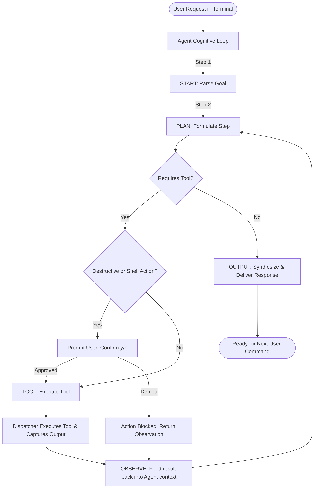

# ⚡ AutoCodeX — Autonomous CLI AI Coding & Automation Assistant

[](https://www.python.org/downloads/)
[](https://groq.com/)
[](https://docs.pydantic.dev/)
[](https://opensource.org/licenses/MIT)

An autonomous, terminal-native AI Coding and Task Execution Agent built in **Python**, powered by **Groq Cloud's ultra-fast LPU inference engine**, and structured with **Pydantic v2**.

Operating on the **ReAct (Reasoning + Acting)** and **Chain-of-Thought (CoT)** execution loop, the agent plans multi-step solutions, inspects workspaces, creates and edits source code files, executes shell commands, and reports verified results directly to your terminal.

---

## 🚀 Key Capabilities

- **📁 File System Operations:**
  - `list_files(path)`: Explore directories, inspect structures, and verify file paths.
  - `read_file(path)`: Read and inspect codebase contents.
  - `write_file(path, content)`: Autonomously write full scripts, configs, and documentation.
  - `edit_file(path, find_text, replace_text)`: Target and refactor code without rewriting entire files.
- **💻 Safe Shell Command Runner:**
  - `run_command(command)`: Execute terminal commands (e.g. `python script.py`, `pytest`, `git status`) and capture real `stdout`/`stderr` outputs.
- **🌦️ Utility Tools:**
  - `get_weather(city)`: Fetch live weather conditions via `wttr.in`.
- **🛡️ Human-in-the-Loop Safety Guard:**
  - **Permission Check:** Prompts for explicit user confirmation `(y/n)` before executing any shell command or overwriting existing files.
  - **Protected Git Operations:** Strictly prohibits automated `git push` commands—pushing to remote repositories remains exclusively under human control.
- **🛡️ Strict JSON Schema Validation:**
  - Guarantees deterministic, machine-readable steps using Groq's strict schema compliance (`strict: True`, `additionalProperties: false`).
- **🔄 Fault-Tolerant ReAct Loop:**
  - Protected against runaway token drain and infinite loops via a dynamic `max_steps_per_query` guard.

---

## 🏗️ Architecture & Execution Loop



---

## 📂 Project Structure

```text
autocodex/
├── Agent.py            # Core CLI Agent engine, tool dispatcher, & ReAct loop
├── requirements.txt    # Python dependencies
├── .env.example        # Environment variable configuration template
├── .gitignore          # Ignores .env and cache directories
└── README.md           # Project documentation
```

---

## ⚡ Quickstart

### 1. Prerequisites
- **Python 3.10+**
- A **Groq Cloud API Key** ([Get your free key here](https://console.groq.com/keys))

### 2. Clone and Setup

```bash
# Clone the repository
git clone https://github.com/Rohit18457/AutoCodeX.git
cd AutoCodeX

# Create and activate virtual environment
python -m venv venv
# On Windows:
.\venv\Scripts\activate
# On Linux/macOS:
source venv/bin/activate

# Install dependencies
pip install -r requirements.txt
```

### 3. Configure API Key

Create a `.env` file from the example template:

```bash
cp .env.example .env
```

Open `.env` and paste your Groq API key:

```env
GROQ_API_KEY=gsk_your_groq_api_key_here
```

### 4. Run the CLI Assistant

```bash
python Agent.py
```

---

## 💬 Live Interaction Example

```text
============================================================
🤖 CLI AI Coding & Automation Assistant Started
Commands: Type your task or type 'exit' to quit.
============================================================

You > create a python script named math_demo.py that calculates factorials and test it.

🔥 You want to create a script named math_demo.py that calculates factorials and test it.
🧠 I will write math_demo.py with a factorial function and a test call.
🛠️ Tool: write_file
   Input: {"path": "math_demo.py", "content": "def factorial(n):\n    return 1 if n <= 1 else n * factorial(n - 1)\n\nprint('Factorial of 5 is:', factorial(5))\n"}
👀 Observation:
Successfully wrote 102 characters to 'math_demo.py'.

🧠 Now I will execute the script using run_command to verify it works.
🛠️ Tool: run_command
   Input: {"command": "python math_demo.py"}
👀 Observation:
Factorial of 5 is: 120

🤖 Answer:
Created 'math_demo.py' and tested it successfully. Output: Factorial of 5 is: 120.
```

---

## 🛠️ Tech Stack

| Component | Technology | Role |
| :--- | :--- | :--- |
| **LLM Inference** | [Groq Cloud](https://groq.com/) (`qwen/qwen3.8-27b`) | Sub-second LPU reasoning & generation |
| **Data Validation** | [Pydantic v2](https://docs.pydantic.dev/) | Strict JSON schema definitions & validation |
| **Runtime & Execution** | Python `subprocess` & `os` | Sandboxed file I/O & command execution |
| **Networking** | `requests` | Weather integration |
| **Configuration** | `python-dotenv` | Secure API key handling |

---

## 📜 License

Distributed under the [MIT License](LICENSE).
